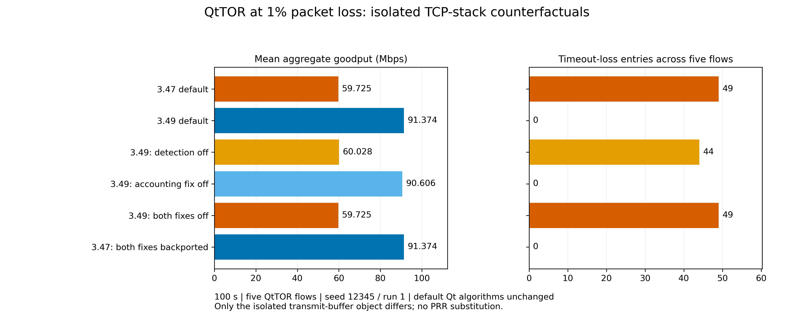
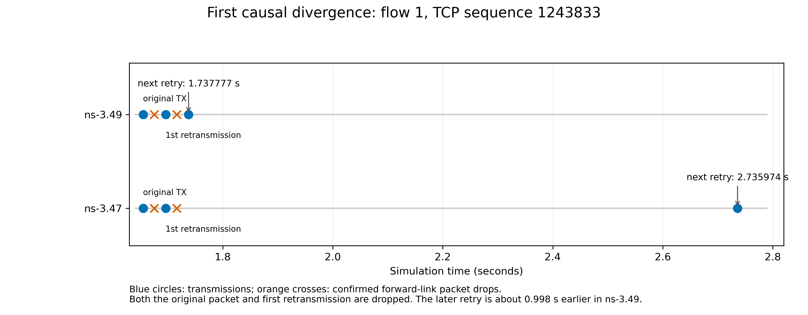

# QtTOR at 1% packet loss: ns-3.47 versus ns-3.49

## Conclusion

For seed 12345/run 1, the 31.649692 Mbps QtTOR goodput difference is caused by two changes in the TCP transmit buffer's SACK handling. The dominant change detects a lost retransmission using later SACK evidence, allowing another retransmission without waiting for the retransmission timeout. The second change clears retransmission accounting when a retransmitted segment is SACKed.

This conclusion is supported by counterfactual tests in both directions: removing both changes from an isolated ns-3.49 library reproduces ns-3.47 exactly; backporting both changes into an isolated ns-3.47 library reproduces ns-3.49 exactly. Aggregate samples, per-flow samples, recovery-event traces, recovery summaries and final totals match byte for byte in each paired comparison.

The installed/default QtSDR and QtTOR algorithms, simulation drivers and internet libraries were not modified. [Before](default-hashes-before.json) and [after](default-hashes-after.json) checksums cover both versions' relevant default sources and engines. All diagnostic files are confined to this study directory. No default results or graphs were replaced. This study is published in its own diagnostic folder; compiled diagnostic binaries are excluded, with their recorded hashes and rebuild scripts retained.

## Controlled 100-second QtTOR experiments

All runs use five homogeneous QtTOR flows, the same original start/sampling timing, 100 Mbps bottleneck, 1% forward packet-error probability, SACK enabled, Classic Recovery, seed 12345/run 1, and unchanged controller parameters. Only the diagnostic library's transmit-buffer object is substituted. Passive driver copies collect state transitions and retransmissions.

| Engine and isolated change | Goodput (Mbps) | Mean RTT (ms) | Mean Power | Timeout-loss entries |
| --- | ---: | ---: | ---: | ---: |
| ns-3.47 default | 59.724793 | 42.0094 | 0.578058 | 49 |
| ns-3.49 default | 91.374485 | 41.7028 | 0.878669 | 0 |
| ns-3.49: retransmission-loss detection disabled | 60.027831 | 41.6654 | 0.581663 | 44 |
| ns-3.49: SACKed-retransmission accounting fix disabled | 90.605655 | 41.5364 | 0.874618 | 0 |
| ns-3.49: both changes disabled | 59.724793 | 42.0094 | 0.578058 | 49 |
| ns-3.47: both changes backported | 91.374485 | 41.7028 | 0.878669 | 0 |

Timeout-loss entries count transitions into `CA_LOSS` across all five senders. In this TCP implementation, `ReTxTimeout()` enters that state. Counts are not the number of corrupted packets. The figures do not represent independent replications or confidence intervals.

The individual ablations show that detecting lost retransmissions accounts for most of the throughput gain. The accounting correction has a smaller effect. Because timing and subsequent random-error draws change with TCP behavior, the individual ablation effects should not be added as an exact linear decomposition.

[Summary CSV](diagnostic-summary.csv) includes goodput, RTT, Power, fairness, retransmission counts and sampled congestion windows for all six cases and the two QtSDR controls. [Validation JSON](validation.json) records the exact-match and unchanged-default checks.

## Packet-level mechanism

Two additional three-second runs trace actual forward-link error drops. Their pre-stop aggregate measurements match the corresponding 100-second diagnostic runs exactly.

For flow 1, TCP sequence 1243833:

| Event | ns-3.47 time (s) | ns-3.49 time (s) |
| --- | ---: | ---: |
| Original transmission | 1.655158509 | 1.655158509 |
| Original packet dropped by the error model | 1.675289871 | 1.675289871 |
| First retransmission | 1.696167253 | 1.696167253 |
| First retransmission dropped by the error model | 1.716298615 | 1.716298615 |
| Next transmission of the same sequence | 2.735974397 | 1.737777451 |

ns-3.49 retransmits again 41.610 ms after the first retransmission. ns-3.47 waits 1.039807 s between those attempts, enters timeout-loss recovery and resets cwnd to one MSS. The ns-3.49 retry is 0.998197 s earlier. The loss of both the original and its retransmission is directly observed in the device's `PhyRxDrop` trace, not inferred solely from throughput.

The older engine consequently experiences repeated delivery stalls and window resets. The two default QtTOR runs have 470 versus one zero-delivery flow intervals after 0.2 seconds (0.1-second samples). Their mean RTTs differ by only 0.3066 ms, while goodput rises by 31.649692 Mbps and mean normalized Power by 0.300611. The main performance change is sustained delivery and loss recovery, rather than a large reduction in RTT.

## Why the QtTOR effect is much larger than the QtSDR effect

The two extra QtSDR control runs reproduce the archived QtSDR results exactly. QtSDR has 58 timeout-loss entries in ns-3.47 and none in ns-3.49, but its goodput changes only from 93.658850 to 94.541320 Mbps. Therefore, timeout count alone does not explain the size of the QtTOR penalty.

The measured congestion-window response differs: after the first second, QtTOR's median sampled per-flow cwnd is 39.900 packets in ns-3.47 and 67.450 in ns-3.49; the ns-3.47 QtSDR control has a median of 75.050 packets. QtTOR's lower sustained window in the older recovery trajectory is consistent with its much lower sending rate. Its optimizer explicitly consumes current cwnd, bytes in flight and a history-dependent service-rate estimate, so recovery changes feed back into subsequent controller decisions.

The transmit-buffer changes are experimentally isolated as the cause of the QtTOR cross-version difference. This study does not separately isolate which internal optimizer/history term makes QtTOR more sensitive than QtSDR; attributing the entire amplification to one particular optimizer term would go beyond the evidence.

## Source evidence

- `ns-3.49/src/internet/model/tcp-tx-buffer.cc`, lines 821–830: clear `m_retrans` accounting for a retransmission acknowledged by SACK.
- The same file, lines 836 and 872: collect the newest SACKed send time and invoke `MarkRetransmittedSegmentsLost()`.
- The same file, lines 934–962: retransmissions sent before later-SACKed packets can be marked lost again and removed from retransmission-in-flight accounting.
- `ns-3.47/src/internet/model/tcp-socket-base.cc`, lines 3953 and 4054–4064: retransmission timeout, `CA_LOSS` entry and reset to one MSS.
- `ns-3.47/src/internet/model/tcp-qt-tor.cc`, lines 383–425: cwnd/bytes-in-flight measurements, persistent service-rate estimation and the trajectory-control update.
- `ns-3.49/CHANGES.md` records SACK loss-detection and retransmission-accounting corrections between the releases. PRR changes are not the explanation for this experiment: the resolved recovery algorithm is Classic Recovery throughout, and only the transmit-buffer changes are needed to exchange the observed results.

## Files, isolation and reproduction

`experiment-index.json` identifies the six QtTOR cases; `qtsdr-control-index.json` identifies the two control cases. Each case has resolved configuration, aggregate/per-flow measurements, final metrics, recovery events, recovery summaries and a loader log. Loader logs verify that each process used the intended default or isolated internet library. `results/packet-drop-confirmation-ns347/` and `results/packet-drop-confirmation-ns349/` contain the short packet-drop checks.

`ns-3.47/` and `ns-3.49/` inside this study contain only diagnostic driver copies, isolated transmit-buffer sources and separately linked libraries. Qt controller objects in those libraries are the unchanged objects from the default builds. The reverse backport inlines the helper inside `Update()` to retain the installed ns-3.47 class declaration and ABI.

Six scripts preserve the commands and transformations: `build_diagnostics.py`, `run_diagnostics.py`, `backport_diagnostics.py`, `confirm_packet_drop.py`, `run_qtsdr_controls.py` and `analyze_diagnostics.py`. They require the existing macOS release builds and Python/NumPy/Matplotlib for plotting. To repeat without replacing these results, copy the six scripts into a new sibling directory under `iet-sims/diagnostics/`, then run them in that order. Put the configured Ninja executable on `PATH`. The simulation scripts intentionally refuse to overwrite existing case outputs.

These conclusions apply to the tested configuration and seed/run. Configured error probabilities and RNG streams are matched, but after packet schedules diverge the realized packet losses need not remain paired. A multi-seed robustness study would be needed to estimate the average version effect and its variability. Keep simulator-version labels in reported loss results; do not silently mix ns-3.47 and ns-3.49 metrics or alter the default algorithms to compensate for this engine difference.
